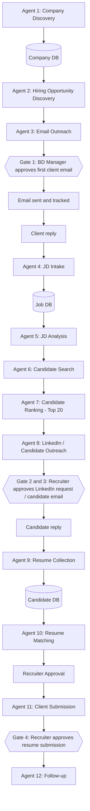

# Implementation Plan — AI Agent Platform for Engineering Staffing & Client Acquisition

**Status as of:** 2026-11-24  
**Source requirements:** [01_Business_Requirements_Document.md](01_Business_Requirements_Document.md)

---

## Implementation phases and current status

Ten phases run about 32 weeks to go-live, with overlapping tracks. Update the **Status**, **% Done** and **Status notes** columns as work moves.

**Status values:** `Not started` · `In progress` · `Blocked` · `Done`

| Phase | Name | BRD scope | Weeks | Key deliverables | Exit criteria (summary) | Status | % Done | Status notes |
| --- | --- | --- | --- | --- | --- | --- | --- | --- |
| 0 | Discovery and setup | §1, §2, §11, §12 | 1–3 | Scope baseline, stack decision record, compliance checklist, KPI baseline, environments | Open questions Q1–Q14 answered for Phase 0; licences confirmed; legal sign-off | In progress | 80% | BRD analysed, plan drafted; 14 of 15 open questions resolved (Q15 pending legal confirmation); default adapters chosen; cloud-agnostic hosting and app stack decided; compliance checklist drafted, awaiting legal review; timing-study template ready, Q12 baseline to be measured; environment plan, local stack and container images (API, scheduler, web app) done; hosting on Podman for now (2026-11-25), cloud choice and its Terraform module deferred |
| 1 | Core platform and data foundation | §7, §8, §9, §10, §11 | 3–8 | Company / Job / Candidate DBs, 6 roles, approval-gate engine, shared AI services | DBs live; roles enforced; no action fires without approval; parsing and search work | In progress | 75% | Built and unit-tested: core schema (migrations 0001-0004), approval-gate engine with PostgreSQL store, opt-out registry, Outreach Service with delivery log, daily send cap and open/reply tracking, OIDC sign-in and roles, review-queue and Administrator APIs, LangGraph gate workflow resumed on decision. 5.4 shared AI services: LLM gateway (versioned prompts, structured output, cost per template, Claude adapter with refusal fallback), engineering skill dictionary, embeddings and semantic search (in-memory and Qdrant adapters). Company / Job / Candidate repositories (in-memory and PostgreSQL) and APIs. 204 tests pass locally (11 for the deep agents, with a scripted model); the 18 PostgreSQL tests run in GitHub Actions CI. Agentic layer on LangGraph deep agents (section 5.4a). Web app, first increment (`web/`, Next.js): sign-in, role-based navigation, KPI dashboard, approval queue (approve, edit, reject, package preview), jobs with field confirmation, ranking, engagement and submissions, follow-ups, AI agents, client portal; `GET /me`; local demo data (`RAP_DEMO_DATA`). Second increment: company sign-in (OIDC, PKCE) in the web app; companies and outreach, candidates with resume upload and erasure, LinkedIn tasks, widened search (S12), engagement outcomes, Administrator screens (users, gates, ranking weights, cadence, AI usage, access log). Open: resume parser adapter (Affinda), production embedding model, cloud vault adapters |
| 2 | Client acquisition | Agents 1–3 | 7–12 | Company discovery, hiring-opportunity signals, approved and tracked client emails | 500 companies in a test month; 100% first emails approved; tracking live | In progress | 60% | Built and tested end to end in memory: Agent 1 (criteria filter, domain de-duplication, contact-role mapping, CSV import of industry-database lists), Agent 2 (career-page JobPosting reading with robots.txt, 27 target roles, Q10 priority score, stale expiry, Hiring History), Agent 3 (contact choice, opt-out and CASL checks, Claude or BRD-template draft, compliance footer with signed unsubscribe link, first-client-email gate), Microsoft 365 and Gmail adapters, one-click unsubscribe. Follow-up cadence built in Phase 7; multi-source merge (S3) and scheduled re-check (S4) in Phase 8. Open: licensed provider adapters (Apollo, ZoomInfo, Crunchbase, D&B need contracts and API docs), open tracking pixel, test month against the 500-company exit criterion |
| 3 | JD intake and analysis | Agents 4–5 | 11–15 | Reply classification, JD extraction, structured searchable job records | Extraction accuracy meets agreed threshold; JD searchable within 15 min | In progress | 70% | Built and tested: inbound email webhook; Agent 4 reply classification (Claude, rule fallback), unsubscribe honoured across channels, JD extraction to one Job record per position with low-confidence fields for Account Manager review, recruiter round-robin; Agent 5 search profile with canonical skills, missing location/visa/rate flagged, semantic search; job review API; PDF and Word (.docx) attachments read by the inbound webhook (text layer; scanned, encrypted and old .doc files reported back, not guessed). Built-in mailbox reader (every 2 minutes, Gmail or Microsoft 365, migration 0012): replies and JDs routed to Agents 4 and 9, bounce reports to S6, auto-replies to S9, each message handled once across replicas, failures retried 3 times and alerted; the webhooks stay for other mail routing. Open: OCR for scanned JDs if needed, accuracy measurement on real CBS JDs (exit criterion) |
| 4 | Candidate search and ranking | Agents 6–7 | 14–19 | Multi-source search, 0–100 score, ranked Top 20 with reasons | Recruiters rate ≥10 of Top 20 as qualified on test JDs | In progress | 60% | Built and tested in memory: resume intake (Claude parser with rule fallback, de-duplication by email, phone and LinkedIn URL, semantic index; names excluded from matching text); Agent 6 search (internal Candidate DB by skills and semantic match, licensed-source adapter interface with write-back); Agent 7 ranking (hard filters for must-have skills and work authorisation, 0-100 score from the ten BRD components with Administrator-set weights, Q9 communication score, plain-language strengths and gaps); recruiter verdicts and re-ordering that survive re-ranking; migration 0005 and APIs. Open: licensed job-board adapters (Dice, CareerBuilder, Monster, Indeed, ZipRecruiter need licences and API docs), weight tuning from feedback, exit-criterion test on past CBS JDs |
| 5 | Candidate engagement | Agents 8–9 | 18–22 | Approved LinkedIn / email outreach, resume and details collection | No message sends without approval; ≥90% complete candidate data; consent recorded | In progress | 60% | Built and tested end to end in memory: Agent 8 drafts BRD-template LinkedIn notes (300-character limit) and candidate emails, both behind the recruiter approval gate; opt-out, duplicate-contact and weekly LinkedIn-limit checks; LinkedIn task list with sent and outcome tracking (Q15). Agent 9: approval-gated request email with a secure, expiring upload link (token hash only stored); candidate page for resume, the seven details and two explicit consents (store; submit for this job); candidate email replies routed to Agent 9 (interest, details, written consent, unsubscribe); completion rate per job for the 90% exit criterion; reminder dates for Agent 12. Migration 0006. PDF and Word resume upload on the candidate's secure link and for recruiters (`POST /candidates/upload`); resumes attached to candidate email replies are read too. Open: LinkedIn Recruiter InMail if licensed, legal review of consent wording (checklist P1) |
| 6 | Matching and client submission | Agents 10–11 | 21–25 | Match reports, recruiter approval, client submission packages | Median JD-to-first-submission <24 h; 100% submissions approved | In progress | 70% | Q8, Q14 resolved. Built and tested end to end in memory: Agent 10 match report (structured ranking model + resume-to-JD embedding similarity + LLM review over the JD, rule-based fallback): score, strengths, concerns, missing skills, interview-probability estimate, submission notes; missing must-have and work-authorisation flags shown, never dropped (S17). Recruiter step: edit notes and package, right-to-represent confirmation, flag acknowledgement, candidate consent for the job (P2), duplicate block per client (S18, also a partial unique index), other-agency warning. Agent 11: nine-item package and cover email behind the resume-submission gate; sent copy kept; rejection reason kept (S19); engagement set to Submitted; client follow-up date for Agent 12. Client portal: own sent submissions and interview / hold / reject feedback (Q8). KPIs per job: hours to first submission, approved-with-consent rate, interview rate. Migration 0007. Branded PDF or Word package (header band, nine BRD items, skill matrix table, resume, confidentiality footer) rendered only from the approved content and attached to the submission email; recruiter preview `GET /submissions/{id}/package` gives the same bytes the client receives. Open: pilot timing |
| 7 | Follow-up | Agent 12 | 24–27 | Reminders for client, candidate, interview, offer, feedback, start date | Every open item has a next reminder date | In progress | 85% | Q13 resolved. Built and tested end to end in memory: Agent 12 sweep (idempotent `POST /follow-ups/run`) keeps one item per open step: client email with no reply (S8), submission and interview feedback (S20), candidate with no reply, missing details, interview scheduling and prep, offer, start-date check-ins. Admin cadence per type (default 3, 7, 14 days, then stop). Due messages are drafted into the same approval gates; LinkedIn follow-ups stay manual (Q15); opted-out people are not chased. Placement pipeline on submissions (Interview, Offer, Started, Rejected, Withdrawn with next-ranked suggestions, S21). Closing a job cancels pending drafts and follow-ups (S22). Task list per role, overdue alerts, summary. Migration 0008. Built-in scheduler (`python -m recruiting.scheduler`; migration 0011) runs the sweep hourly, delivery retries every 5 minutes and career-page re-checks daily, once per interval across replicas, with overdue and failure alerts in the operations view. Daily reminder digest by email (migration 0014): each staff user's overdue and due-today follow-ups at a set local hour on weekdays, the Administrator's covering everyone's overdue items; sent once per user and day across replicas, failed sends retried and alerted; internal mail, so no approval gate or unsubscribe link (`RAP_REMINDER_DIGEST`). Open: pilot use |
| 8 | E2E testing, KPI dashboard, go-live | §12 | 26–32 | SIT, security and compliance tests, UAT, pilot, KPI dashboard, go-live | UAT sign-off by all roles; zero critical defects; compliance sign-off | In progress | 45% | Built: KPI endpoint for all nine BRD section 12 metrics with target, status and basis (`GET /kpis`), operations view with alerts (email failures and bounces, approvals waiting over 48 h, overdue follow-ups, jobs short of candidates, AI cost), access-denied log (S26), candidate erasure (S23), S16 completeness rule, email bounces (S6: `POST /inbound/bounce`, contact marked invalid, next contact suggested), too few qualified candidates (S12: recruiter task, recruiter-chosen widened search), end-to-end S1 test through the API; two-source merge (S3), scheduled career-page re-check (S4), out-of-office and "JD to follow" reminders (S9), retry with back-off for email sends and external sources (S24); all 27 scenarios pass automated in memory (section 14); go-live runbook (doc 06). Migrations 0009-0011; built-in scheduler with operations alerts. PostgreSQL CI green. Web app CI (type check and build); every BRD role has its screens for UAT. Open: security and penetration test, compliance sign-off, UAT by all roles, 4-week pilot, training, go-live |
| 9 | Future enhancements | Future Enhancements | After go-live | 7 BRD enhancements | Defined per enhancement | Not started | 0% | Only after Phase 8 exit criteria are met |

**Suggested team:** product owner (CBS LLC), solution architect, 2 AI/ML engineers, 2 backend engineers, 1 frontend engineer, 1 integration engineer, QA engineer, part-time compliance/legal advisor, recruiter SMEs for review and UAT.

---

## 1. Purpose, scope and planning principles

This plan delivers the BRD's 12-agent recruiting and client-acquisition platform for CBS LLC in 10 phases over about 32 weeks, with every deliverable traced back to a BRD section. Nothing outside the BRD is added; where the BRD is silent or inconsistent, the gap is logged as an open question (Section 2) rather than decided here.

**In scope (from the BRD)**

- 12 functional agents (BRD §6, Agents 1–12) and the high-level workflow (BRD §5).
- AI components: NLP, resume parsing, JD parsing, semantic search, LLM, vector database, embedding search, RAG, recommendation engine (BRD §7).
- Company, Job and Candidate databases (BRD §8).
- Six user roles: Administrator, Business Development Manager, Recruiter, Account Manager, Sales Manager, Client (BRD §9).
- Four mandatory human approval gates (BRD §10).
- Technology choices from the recommended stack (BRD §11).
- The nine KPIs and their targets (BRD §12).
- Future enhancements, scheduled only after the core workflow works (BRD "Future Enhancements").

**Planning principles**

1. **BRD fidelity.** Each phase lists the BRD sections it delivers; Section 15 maps every requirement to a phase and a test.
2. **Human in control.** No outreach or submission leaves the system without the approval gates in BRD §10.
3. **Compliance by design.** LinkedIn terms of service and privacy laws (BRD §1) are acceptance criteria, not afterthoughts.
4. **Workflow order.** Phases follow the BRD pipeline, so each phase's output feeds the next and can be tested end to end.
5. **Measurable.** Each phase has exit criteria tied to the KPIs in BRD §12.

## 2. Assumptions and open questions

The plan runs on the working assumptions below. Each open question needs a CBS LLC decision before the phase named next to it starts.

**Working assumptions**

- CBS LLC is the operating company (named in the BRD's sample emails).
- The BRD's Agent 1 is the "Company Search Agent" in the workflow, and Agent 5 is the "JD Analyzer Agent"; they are the same agents under two names.
- Data from LinkedIn is used only through approved, ToS-compliant methods (official APIs or partner tools such as LinkedIn Recruiter, or manual recruiter action). No scraping.
- Every option in BRD §11 is supported through pluggable adapters; Phase 0 only chooses which one is active first per layer.
- **Pluggable integrations (decided 2026-11-22):** data providers, job boards / candidate sources and email providers sit behind common connector interfaces, so they can be added, swapped or removed by configuration for easy maintenance (Q4, Q5, Q11).
- **Cloud-agnostic hosting (decided 2026-11-22):** the BRD names no hosting cloud, so the platform runs as containers on any cloud (Azure, AWS, Google Cloud) or on-premises. Cloud-specific services (secrets vault, managed PostgreSQL, object storage, container runtime) sit behind adapters and per-cloud infrastructure modules, chosen by configuration. See [05_Environment_Setup_Plan.md](05_Environment_Setup_Plan.md).
- **Application stack (decided 2026-11-22):** Python 3.12 with FastAPI for the backend and agents (LangGraph is Python-first); Next.js (React, TypeScript) for the role-based web app and client portal.
- Timeline assumes one cross-functional team working in parallel tracks.

**BRD gaps and inconsistencies to resolve**

| # | Question | BRD reference | Needed by | Answer |
| --- | --- | --- | --- | --- |
| Q1 | Target industry lists differ: §3 lists Aerospace, Energy, Life Sciences; Agent 1 lists Oil & Gas, Semiconductor, Industrial Automation instead. Use the union of both? | §3, Agent 1 | Phase 2 | **Resolved (2026-11-22):** use the union of both lists (14 industries). |
| Q2 | Agent 2 searches 10 roles; §4 lists 27 target positions. Should hiring discovery cover all 27? | §4, Agent 2 | Phase 2 | **Resolved (2026-11-22):** search all 27 §4 positions. |
| Q3 | Is Mexico in scope at launch or later ("optional")? Affects data sources, language and privacy law. | Agent 1 | Phase 0 | **Resolved (2026-11-22):** USA and Canada at launch; Mexico in a later phase after go-live. |
| Q4 | Which data providers are licensed or to be bought (ZoomInfo optional, Apollo, Crunchbase, D&B)? | Agent 1 | Phase 0 | **Resolved (2026-11-22):** provider-agnostic. Adapters for all BRD options (LinkedIn, company websites, industry databases, ZoomInfo, Apollo, Crunchbase, D&B), switchable by configuration. |
| Q5 | Which job boards does CBS LLC hold resume-database licences for (Dice, CareerBuilder, Monster, Indeed Resume, ZipRecruiter)? | Agent 6 | Phase 0 | **Resolved (2026-11-22):** source-agnostic. Adapters for all BRD sources (LinkedIn, Internal ATS, Company DB, Resume DB, Dice, CareerBuilder, Monster, Indeed Resume, ZipRecruiter, Recruiting CRM), enabled per licence by configuration. |
| Q6 | Is there an existing ATS/CRM (Bullhorn, RecruitCRM, Zoho Recruit, Salesforce) to integrate with, or is the BRD's Candidate and Job database the system of record? | §8, §11 | Phase 0 | **Resolved (2026-11-22):** no existing ATS/CRM; the platform's Job and Candidate databases are the system of record. Optional sync adapters for all BRD CRM/ATS options (Bullhorn, RecruitCRM, Zoho Recruit, Salesforce) are included, off by default. |
| Q7 | §10 requires approval before "candidate outreach emails", but no agent sends candidate emails. Is candidate email outreach part of Agent 8 or Agent 9? | §10, Agents 8–9 | Phase 5 | **Resolved (2026-11-22):** not tied to one agent. A shared, channel-agnostic Outreach Service (LinkedIn, email, future channels) sits behind the approval gate and is callable by Agent 8, Agent 9 and Agent 12. |
| Q8 | What does the "Client" role see and do in the platform (view submissions, give feedback, upload JDs)? | §9 | Phase 1 | **Resolved (2026-11-22):** full client portal covering every client touchpoint in the BRD: view submissions and submission packages, give feedback and interview / offer decisions, upload new JDs, track job and candidate status (interview, offer, start date). Only their own data. |
| Q9 | How is "Communication Score" measured for ranking (response quality, response time, recruiter rating)? | Agent 7 | Phase 4 | **Resolved (2026-11-22):** configurable weighted rules: reply speed, reply completeness, recruiter rating. Admin can change factors and weights. |
| Q10 | How is the 0–100 priority score for hiring opportunities defined (posting age, volume, role fit)? | Agent 2 | Phase 2 | **Resolved (2026-11-22):** configurable weighted rules: posting age, number of open roles, role fit to §4 positions. Admin can change factors and weights. |
| Q11 | Which email platform: Microsoft 365 or Gmail? Which domain(s) will send outreach? | §11 | Phase 0 | **Resolved (2026-11-22):** both Microsoft 365 and Gmail API adapters are built; provider and sending domains are configuration. |
| Q12 | Baseline for "reduce manual effort by over 80%": what is today's effort per JD and per client? | §2 | Phase 0 | Open: measured by the Phase 0 timing study (activity 3). |
| Q13 | Follow-up cadence: how many client follow-ups, at what intervals, before stopping? | Agents 3, 12 | Phase 2 | **Resolved (2026-11-22):** configurable cadence set by Admin; default 3 follow-ups at 3, 7 and 14 days, then stop. |
| Q14 | Who approves at each gate (role), and is a second approver ever needed? | §10 | Phase 1 | **Resolved (2026-11-22):** configurable per gate. Defaults: BD Manager approves first client email; Recruiter approves LinkedIn requests, candidate outreach and resume submissions. Admin can change the role and add a second approver per gate. |
| Q15 | LinkedIn has no public API for connection requests, and its User Agreement bans automation. How does Agent 8 send requests? | Agent 8, §1, §10 | Phase 5 | **Resolved (2026-11-22), pending legal confirmation:** Agent 8 drafts and the recruiter approves, then sends it by hand in LinkedIn or LinkedIn Recruiter and the platform logs it; a LinkedIn Talent Solutions partner integration is explored in parallel. See [compliance checklist C1](03_Compliance_Checklist.md#1-summary-of-what-needs-a-decision). |

## 3. Target solution architecture

Twelve agents run as one orchestrated pipeline over shared databases and AI services, with four human gates that stop any outbound action until a named role approves it.

**Workflow with approval gates (BRD §5, §10)**

**Architecture layers (BRD §7, §8, §11)**

| Layer | Components | Technology options from BRD |
| --- | --- | --- |
| User interface | Role-based web app: review queues, pipeline, dashboards, client portal | Next.js (decided 2026-11-22) |
| Hosting | Containers, managed PostgreSQL, secrets vault, object storage | Not named in BRD; cloud-agnostic by design (Azure, AWS, Google Cloud or on-premises) |
| Orchestration | 12 agents, state, retries, human-in-the-loop pauses | **LangGraph (default, open source)**; CrewAI, Microsoft AutoGen as alternatives |
| Workflow automation | Schedules, triggers, integrations glue | n8n, Make, Zapier |
| AI services | LLM, NLP, resume parsing, JD parsing, embeddings, semantic search, RAG, recommendation engine | GPT-5.5 / GPT-5, Claude, Gemini; Sovren, Affinda, Textkernel |
| Data | Company, Job, Candidate DBs; vector index; documents | PostgreSQL; Pinecone, Weaviate, Qdrant; SharePoint, OneDrive, AWS S3 |
| Integrations | Email, CRM/ATS, data providers, job boards, search | M365 / Gmail APIs; Bullhorn, RecruitCRM, Zoho Recruit, Salesforce; Apollo, Crunchbase, D&B, ZoomInfo; Google Custom Search |
| Governance | Approval log, audit trail, consent and opt-out registry, access control | Built in Phase 1 |

## 4. Phase 0 — Discovery and setup (weeks 1–3)

Phase 0 closes the open questions, fixes the stack and sets KPI baselines, so later phases build without rework.

**BRD coverage:** §1 Objective, §2 Goals, §11 Stack, §12 KPIs.

**Activities**

1. Kick-off and BRD walkthrough with Administrator, BD Manager, Recruiter, Account Manager and Sales Manager representatives.
2. Resolve open questions Q1–Q14 (Section 2) and sign off a scope baseline.
3. Map today's manual process for one client and one JD, and time each step (baseline for the 80% goal and the <24-hour target). Template: [04_KPI_Baseline_Timing_Study.md](04_KPI_Baseline_Timing_Study.md).
4. Choose the **default active** adapter per BRD §11 layer (all options remain available through the connector framework, Section 5.5): orchestration (LangGraph / CrewAI / AutoGen), LLM, workflow automation (n8n / Make / Zapier), CRM/ATS, vector DB (Pinecone / Weaviate / Qdrant), email (M365 / Gmail), search, resume parser (Sovren / Affinda / Textkernel), document storage (SharePoint / OneDrive / S3). PostgreSQL is fixed by the BRD. **Open-source defaults already decided (2026-11-22)** are listed in the table below.
   | Layer (BRD §11) | Default active (open source) | Licence | Other BRD options kept as adapters |
   | --- | --- | --- | --- |
   | AI orchestration | **LangGraph** (agentic graph, state, checkpoints, human-in-the-loop interrupts for the §10 gates) | MIT | CrewAI, Microsoft AutoGen |
   | Database | **PostgreSQL** | PostgreSQL licence | — |
   | Vector database | **Qdrant** (self-hosted) | Apache 2.0 | Weaviate (BSD-3, also open source), Pinecone |
   | Workflow automation | **n8n** (self-hosted) | Sustainable Use License (source-available, free to self-host) | Make, Zapier |
   | LLM | **Claude** (decided 2026-11-22; no open-source option in BRD) | Commercial | OpenAI GPT-5.5, GPT-5, Gemini, all via LLM gateway |
   | Resume parsing | **Affinda** (decided 2026-11-22; no open-source option in BRD) | Commercial | Sovren, Textkernel |
   | Email, document storage | No fixed default (decided 2026-11-22): adapters for all BRD options are built; Administrator activates one or more per deployment by configuration | Commercial | Microsoft 365 API, Gmail API; SharePoint, OneDrive, AWS S3 |
   | CRM/ATS, data providers, job boards | Commercial services named in BRD | Commercial | All as adapters (Section 5.5) |

5. Inventory current data-provider, job-board and email accounts and register them as initial connectors; no provider is hard-coded (Q4, Q5, Q11).
6. Compliance review: LinkedIn user agreement and API terms, CAN-SPAM, Canada's CASL, GDPR/CCPA-style privacy obligations, and Mexico's LFPDPPP if Mexico is in scope. Draft checklist for legal review: [03_Compliance_Checklist.md](03_Compliance_Checklist.md).
7. Set up environments (dev, test, prod), source control, CI/CD, secrets vault, and email-sending domain warm-up. Plan: [05_Environment_Setup_Plan.md](05_Environment_Setup_Plan.md).

**Deliverables:** signed scope baseline, stack decision record, compliance checklist, KPI baseline sheet, environments live.

**Exit criteria:** all "Phase 0" questions answered; licences confirmed; legal sign-off on outreach and data-use approach.

## 5. Phase 1 — Core platform and data foundation (weeks 3–8)

Phase 1 builds the shared backbone every agent uses: the three databases, roles, the approval-gate engine and the AI services.

**BRD coverage:** §7 AI Components, §8 Databases, §9 User Roles, §10 Approval Gates, §11 Stack.

**5.1 Databases (PostgreSQL + vector DB)**

| Database | BRD fields | Added for traceability |
| --- | --- | --- |
| Company | Company Name, Industry, Revenue, Employees, Locations, Contacts, Hiring History | Source, last-verified date, outreach status, consent / opt-out flag |
| Job | Job ID, Client, Skills, Priority, Status, Recruiter | Link to source email, parsed JD fields from Agents 4–5 |
| Candidate | Resume, Skills, Projects, LinkedIn, Experience, Availability, Location, Visa | Source, consent status, outreach history, retention date |

The last column holds only audit fields needed to prove BRD §10 approvals and privacy compliance; it adds no new business features. Resume files go to the chosen document store (SharePoint / OneDrive / S3). Embeddings of resumes and JDs go to the vector DB for semantic search.

**5.2 Role-based access (BRD §9)**

| Role | Main permissions |
| --- | --- |
| Administrator | Users, settings, templates, integrations, audit log |
| Business Development Manager | Company discovery, client email approval and sending |
| Sales Manager | Pipeline view of clients, outreach results, KPIs |
| Account Manager | Client relationship, JD intake review, submission approval |
| Recruiter | Candidate search, ranking review, LinkedIn and candidate outreach approval, resume collection |
| Client | Client portal (Q8): view own submissions and packages, give feedback and interview / offer decisions, upload new JDs, track job and candidate status; own data only |

**5.3 Approval-gate engine (BRD §10)**

- One reusable review queue: the agent drafts, a named role reviews, approves, edits or rejects, and only then the action fires.
- Four gate types configured: first client email, LinkedIn connection request, candidate outreach email, client resume submission.
- Every decision is logged with user, time, version sent and reason for rejection.
- Hard block: the send/submit APIs refuse any action without an approval record.
- Approver per gate is configurable (Q14). Defaults: BD Manager for first client email; Recruiter for LinkedIn requests, candidate outreach and resume submissions. Admin can change the role and require a second approver per gate.

**5.4 Shared AI services (BRD §7)**

- LLM gateway with prompt templates, version control and cost tracking.
- Resume parsing and JD parsing services.
- Embedding service, vector index and semantic search API.
- RAG layer over the Company, Job and Candidate databases.
- Recommendation engine scaffold (used by ranking and matching).
- Agent orchestration on **LangGraph**: each of the 12 agents is a node or sub-graph; shared state per company / job / candidate; Postgres checkpointer for durable runs and retries; `interrupt` points implement the four §10 approval gates, so a run pauses until the approver acts in the review queue, then resumes.

**5.4a Agentic layer: deep agents on LangGraph (built 2026-11-24)**

With `RAP_AGENTS_ENABLED=true` (and Claude as the model), four deep agents (LangGraph graphs built with the `deepagents` library: planning to-do list, subagents through a `task` tool, a scratchpad kept in the run's own state) drive the workflow. With it off, the deterministic agents do the same work as before.

| Deep agent | BRD agents | Runs on | Subagents | Pauses for a person |
| --- | --- | --- | --- | --- |
| Business development | 1–3 | daily (scheduler) or on demand (BD Manager) | market researcher, outreach writer | every first email (§10 gate) |
| Intake | 4–5 | each inbound email (mailbox reader) | none | none; falls back to the deterministic agents if it fails |
| Recruiting coordinator, one per job | 6–11 | every 30 minutes per open job without a run in 6 hours, or on demand (recruiter) | sourcer, engager, submitter | widened search (S12); every outreach, details request and submission (§10 gates) |
| Follow-up | 12 | hourly (scheduler) or on demand | none | every drafted follow-up (§10 gates) |

Guardrails are in the tools, not only in the prompts: no tool sends anything (drafts go to the approval gates); approvals, recruiter verdicts, the right-to-represent confirmation, consent, placement stages and client feedback have no tool; opt-out, CASL, bounce, consent and duplicate-submission checks run inside the wrapped deterministic code; recruiting tools are bound to one job and intake tools to one email; the coordinator itself has only read tools (its subagents act); there is no shell and no file access outside the run's state; a daily run limit caps cost. Model: Claude Opus 5.5 at `high` effort with server-side refusal fallback; every model call's tokens and cost are recorded per agent in the usage ledger. Each run is a durable LangGraph thread (PostgreSQL checkpointer) with a readable record (`agent_run`, migration 0013): status, the actions its tools took, what it waits for, its report. API: `GET /agents`, `POST /agents/{agent}/runs`, `GET /agents/runs[/{id}]`, `POST /agents/runs/{id}/decisions`.

**5.5 Connector framework and integrations (Q4, Q5, Q7, Q11)**

Every integration sits behind a common connector interface. **Adapters are built for all options named in the BRD** and enabled, disabled or swapped by the Administrator through configuration (credentials in the vault, rate limits per adapter). Adding a new provider later means one new adapter; agent logic does not change.

| Connector type | Used by | Adapters delivered (all BRD options) |
| --- | --- | --- |
| Company data | Agent 1, Agent 2 | LinkedIn (sanctioned API / tools only), company websites, industry databases, ZoomInfo, Apollo, Crunchbase, Dun & Bradstreet |
| Job / hiring signals | Agent 2 | Company career pages, Google Custom Search, approved data providers |
| Candidate sources | Agent 6 | LinkedIn (sanctioned tools only), Internal ATS, Company Database, Resume Database, Dice, CareerBuilder, Monster, Indeed Resume, ZipRecruiter, Recruiting CRM |
| Email | Agents 3, 4, 8, 9, 11, 12 | Microsoft 365 API, Gmail API (no fixed default; active provider and sending domains set by configuration) |
| CRM / ATS (optional sync) | Agents 4, 6, 11, 12 | Bullhorn, RecruitCRM, Zoho Recruit, Salesforce. The platform DB stays the system of record (Q6); sync is off by default |
| Resume parsing | Agents 9, 10 | Affinda (default), Sovren, Textkernel |
| Document storage | Agents 9, 11 | SharePoint, OneDrive, AWS S3 (no fixed default; set by configuration) |
| Vector database | Agents 5, 6, 10 | Qdrant (default, open source), Weaviate, Pinecone |
| LLM | All agents | Claude (default), OpenAI GPT-5.5, GPT-5, Gemini (via the LLM gateway) |
| Workflow automation | Schedules, triggers | n8n (default, self-hosted), Make, Zapier |

- **Shared Outreach Service (Q7):** one channel-agnostic service for LinkedIn (sanctioned tools) and email, behind the approval-gate engine. Agent 8, Agent 9 and Agent 12 all send through it; the gate approves, the service delivers and tracks.
- **Default selection:** Phase 0 picks which adapter is active first in each row; the others stay available and can be switched on without code changes.

**Exit criteria:** databases live with seed data; all six roles can sign in with correct permissions; a test action cannot fire without approval; parsing and semantic search return results on sample resumes and JDs.

## 6. Phase 2 — Client acquisition: Agents 1–3 (weeks 7–12)

Phase 2 turns target-company research into approved, tracked outreach emails, aiming at 500+ new companies a month and a client response rate above 15%.

**BRD coverage:** Agent 1 Company Discovery, Agent 2 Hiring Opportunity Discovery, Agent 3 Email Outreach; gate "first client email"; KPIs: companies identified, emails sent, client response rate.

### Agent 1 — Company Discovery Agent

- **Search criteria:** revenue over $100M; USA and Canada at launch, Mexico in a later phase (Q3); industries = union of BRD §3 and Agent 1 lists (Q1): Manufacturing, Automotive, Medical Devices, Industrial Equipment, Aerospace, Energy, Consumer Products, Electronics, Heavy Equipment, Defense, Life Sciences, Industrial Automation, Oil & Gas, Semiconductor.
- **Sources:** LinkedIn (compliant access only), company websites, industry databases, ZoomInfo (optional), Apollo, Crunchbase, Dun & Bradstreet.
- **Output fields:** company name, revenue, industry, location, hiring manager, engineering manager, HR manager, talent acquisition, director of engineering, LinkedIn URL, website, career page, recruiter contacts, email, phone.
- **Build tasks:** provider connectors; de-duplication by domain and legal name; revenue and location filter; contact-role mapping; email verification; write to Company DB with source and date.
- **Schedule:** daily batch run, plus on-demand search by BD Manager.

### Agent 2 — Hiring Opportunity Discovery Agent

- **Searches for** all 27 target positions in BRD §4 (Q2), which include the 10 roles listed under Agent 2.
- **Sources:** company career pages and approved job-data search (BRD §11 Search layer).
- **Output fields:** job title, location, hiring manager, job link, date posted, priority score (configurable weighted rules: posting age, number of open roles, role fit; Q10).
- **Build tasks:** career-page discovery and parsing; title normalisation to §4 role list; link postings to Company DB (updates Hiring History); priority scoring; stale-posting expiry.

### Agent 3 — Email Outreach Agent

- **Inputs:** company, hiring manager, engineering manager, recent hiring activity (from Agent 2).
- **Drafting:** starts from the BRD sample email ("Engineering Talent Support for Your Hiring Needs"), personalised with company name, contact name and open roles; AI-generated subject line.
- **Gate:** every first client email goes to the BD Manager approval queue (BRD §10). Approved emails send through M365 / Gmail API.
- **Tracking:** email tracking, open tracking, response tracking; replies routed to Agent 4.
- **Follow-up reminders:** scheduled per the configurable cadence (Q13); follow-ups after the first approved email use approved templates.
- **Compliance:** unsubscribe link, sender identity and postal address, opt-out list honoured across all agents, daily send caps to protect domain reputation.

**Exit criteria:** 500 qualified companies loaded in a test month; 100% of first emails pass through approval; opens and replies tracked; opt-outs suppressed in under 24 hours.

## 7. Phase 3 — JD intake and analysis: Agents 4–5 (weeks 11–15)

Phase 3 turns a client's reply into a structured, searchable job record within minutes, supporting the target of 40+ new JDs a month.

**BRD coverage:** Agent 4 JD Intake, Agent 5 JD Analysis; Job Database; AI components JD parsing, NLP, LLM.

### Agent 4 — JD Intake Agent

- **Trigger:** an email reply arrives (from Agent 3 tracking) with a JD in the body or as an attachment (PDF, DOCX).
- **Classify the reply first:** JD received / interested, JD to follow / not now / not interested / unsubscribe / out of office. Only JDs continue; the rest update the Company DB and Agent 12 reminders.
- **Extract:** job title, responsibilities, required skills, preferred skills, location, experience, visa status, education, industry, travel, remote/hybrid, salary, contract type, priority.
- **Store** in the Job Database (Job ID, Client, Skills, Priority, Status, Recruiter); assign a recruiter.
- **Review step:** Account Manager confirms extracted fields; low-confidence fields are highlighted. One email with several JDs creates several job records.

### Agent 5 — JD Analysis Agent

- **Extract:** must-have skills, nice-to-have skills, years of experience, industry, software, CAD tools, manufacturing methods, ERP, PLM, Lean, Six Sigma, automation, programming.
- **Skill dictionary seeded from BRD examples:** AutoCAD, SolidWorks, CATIA, Creo, NX, ANSYS, HyperMesh, Abaqus, MATLAB, Python, SAP, Teamcenter, Windchill, Enovia, PLC, Rockwell, Siemens, ABB, Fanuc, GD&T, PFMEA, APQP, PPAP, Control Plan, 8D, DOE, Lean Manufacturing, Six Sigma.
- **Outputs:** a structured search profile (feeds Agent 6) and a JD embedding (feeds semantic search and Agent 10).
- **Handling gaps:** a JD missing must-have data (location, visa, rate) is flagged so the Account Manager can ask the client.

**Exit criteria:** on a test set of real CBS JDs, extracted fields agree with recruiter review on at least an agreed accuracy threshold (set in Phase 0); a JD is searchable within 15 minutes of the email arriving.

## 8. Phase 4 — Candidate search and ranking: Agents 6–7 (weeks 14–19)

Phase 4 produces a ranked Top 20 with reasons for every JD, meeting the target of 10–20 qualified candidates per JD.

**BRD coverage:** Agent 6 Candidate Search, Agent 7 Candidate Ranking; Candidate Database; semantic search, embedding search, RAG, recommendation engine.

### Agent 6 — Candidate Search Agent

- **Search order:** internal sources first (the platform's own Candidate DB as system of record per Q6, Company Database, Resume Database), then licensed job-board resume databases (Dice, CareerBuilder, Monster, Indeed Resume, ZipRecruiter per Q5), then LinkedIn through compliant tools only.
- **Filters:** job title, skills, industry, years of experience, education, location, visa, availability, expected rate, LinkedIn profile, resume.
- **Methods:** structured filter query + semantic (embedding) search against the JD profile from Agent 5; results merged and de-duplicated by email, phone and LinkedIn URL.
- **Write-back:** new candidates saved to the Candidate DB with source and consent status.

### Agent 7 — Candidate Ranking Agent

Scores each candidate 0–100 from the ten BRD components. Weights are configurable by the Administrator; the starting weights below are a proposal to confirm in Phase 0.

| Score component (BRD) | Proposed starting weight |
| --- | --- |
| Skill Match | 25% |
| Industry Match | 10% |
| Years Experience | 10% |
| Project Similarity | 10% |
| Recent Experience | 10% |
| Location | 8% |
| Availability | 8% |
| Education | 7% |
| Resume Quality | 7% |
| Communication Score | 5% (reply speed, reply completeness, recruiter rating; configurable, Q9) |

- **Output:** candidate score (0–100), Top 20 candidates, reason for ranking in plain language per candidate.
- **Hard filters before scoring:** must-have skills and work authorisation where the JD states them.
- **Recruiter review:** recruiter sees the Top 20, can re-order or exclude, and feedback is stored to tune weights.
- **Fairness:** no scoring on protected attributes (age, gender, ethnicity, etc.); names and photos are not model inputs.

**Exit criteria:** for a test set of past JDs, recruiters rate at least 10 of the Top 20 as qualified; ranking explanation shown for every candidate.

## 9. Phase 5 — Candidate engagement: Agents 8–9 (weeks 18–22)

Phase 5 contacts approved candidates and collects their resume and details, aiming at a candidate response rate above 30%.

**BRD coverage:** Agent 8 LinkedIn Outreach, Agent 9 Resume Collection; gates "LinkedIn connection request" and "candidate outreach email".

### Agent 8 — LinkedIn Outreach Agent

- **Drafts** a personalised message from the BRD template ("Hello John, I came across your profile while searching for Manufacturing Engineers…"), filling the candidate's name and the role family.
- **Gate:** the Recruiter approves each connection request and message before it is sent (BRD §10).
- **Sending:** only through LinkedIn-sanctioned channels (for example LinkedIn Recruiter InMail or the recruiter sending from their own account after approval). No browser automation or scraping, and LinkedIn's own weekly invitation limits are respected.
- **Candidate email outreach** (BRD §10 gate): sent through the shared Outreach Service (Q7) with the same draft-approve-send flow, so Agents 8, 9 and 12 all use one approved channel layer.
- **Tracking:** sent, accepted, replied, not interested, do-not-contact.

### Agent 9 — Resume Collection Agent

- **Trigger:** a candidate responds positively.
- **Requests:** resume, availability, visa status, current location, expected rate, notice period, authorisation, preferred location.
- **Collection channel:** a reply email or a secure upload link; the candidate gives consent for CBS to store their data and submit them to named clients.
- **Processing:** resume parsed, Candidate DB updated, missing items chased by reminder (via Agent 12).
- **Hand-off:** once the resume and all eight items are in, the candidate moves to Agent 10.

**Exit criteria:** no LinkedIn or candidate message can send without recruiter approval; resume and the eight data points captured for at least 90% of interested candidates in testing; consent recorded for every stored resume.

## 10. Phase 6 — Matching, recruiter approval and client submission: Agents 10–11 (weeks 21–25)

Phase 6 delivers approved submission packages to clients, targeting first submission under 24 hours from JD receipt and a resume-to-interview ratio above 25%.

**BRD coverage:** Agent 10 Resume Matching, Recruiter Approval step (workflow), Agent 11 Client Submission; gate "submitting resumes to clients".

### Agent 10 — Resume Matching Agent

- **Compares** the parsed resume with the JD profile from Agent 5 (structured match + embedding similarity + LLM review with RAG over the JD).
- **Generates:** match score, strengths, missing skills, interview probability, client submission notes.
- **Rule:** candidates with a missing must-have skill are flagged, not silently dropped; the recruiter decides.

### Recruiter approval

- Recruiter reviews the match report, edits notes, and approves or rejects; the Account Manager can be set as a second approver (Q14).
- Duplicate check: blocks submitting the same candidate to the same client twice, and warns if another agency is known to have submitted them.
- Candidate's right-to-represent confirmation is required before approval.

### Agent 11 — Client Submission Agent

- **Package contents:** candidate summary, resume, skill matrix, match %, availability, rate, visa, location, key projects.
- **Format:** CBS-branded PDF or DOCX plus a short cover email to the hiring manager; client-portal view (Q8).
- **Gate:** sent only after recruiter approval (BRD §10); the sent version is stored for audit.
- **Status update:** Job DB and Candidate DB set to "Submitted"; Agent 12 schedules client follow-up.

**Exit criteria:** median JD-to-first-submission under 24 hours in pilot; 100% of submissions have an approval record and consent; package contains all nine BRD items.

## 11. Phase 7 — Follow-up Agent: Agent 12 (weeks 24–27)

Phase 7 makes sure no client, candidate or placement step is dropped, supporting the interview-to-offer target above 20%.

**BRD coverage:** Agent 12 Follow-up; Agent 3 "follow-up reminders".

| Follow-up type (BRD) | Trigger | Who is reminded / what is drafted |
| --- | --- | --- |
| Client | Outreach email with no reply; submission with no feedback | BD Manager or Account Manager; follow-up draft for approval |
| Candidate | Outreach with no reply; resume or details missing | Recruiter; reminder draft for approval |
| Interview | Interview requested or scheduled | Recruiter: confirm time, prep candidate, collect outcome |
| Offer | Offer expected or extended | Account Manager and Recruiter: track decision and terms |
| Feedback | Interview held with no feedback logged | Account Manager: chase client feedback |
| Start Date | Offer accepted | Recruiter: confirm documents, start-date check-ins |

- Reminders appear in each user's task list and by email; timing rules set by Administrator (Q13), default 3 follow-ups at 3, 7 and 14 days, then stop.
- The email is a daily digest per staff user (`RAP_REMINDER_DIGEST`, at `RAP_DIGEST_HOUR` in `RAP_DIGEST_TIMEZONE`, weekdays unless `RAP_DIGEST_WEEKENDS`): overdue and due-today items with a link to the follow-up list; the Administrator's digest lists overdue items across all staff.
- Status changes in the Job and Candidate DBs drive the pipeline: Sourced → Contacted → Interested → Resume received → Matched → Approved → Submitted → Interview → Offer → Started (or Rejected / Withdrawn at any step).
- Any outbound follow-up message to a client or candidate uses the same approval flow as first contact where BRD §10 applies.

**Exit criteria:** every open item has a next reminder date; no record sits in a status past its time limit without an alert.

## 12. Phase 8 — End-to-end testing, KPI dashboard and go-live (weeks 26–32)

Phase 8 proves the whole pipeline on live clients and hands it to the business with KPI tracking against BRD §12.

**KPI dashboard (BRD §12)**

| Metric | Target | Data source | Current |
| --- | --- | --- | --- |
| New target companies identified | 500+ per month | Company DB (Agent 1) | Live in `GET /kpis`; awaiting pilot data |
| Personalised outreach emails sent | 200–500 per week, after approval | Approval log + email API (Agent 3) | Live in `GET /kpis`; awaiting pilot data |
| Client response rate | >15% | Email response tracking | Live in `GET /kpis`; awaiting pilot data |
| New job descriptions received | >40 per month | Job DB (Agent 4) | Live in `GET /kpis`; awaiting pilot data |
| Qualified candidates identified per JD | 10–20 | Agent 7 Top 20 + recruiter review | Live in `GET /kpis`; awaiting pilot data |
| Candidate response rate | >30% | Agent 8 tracking | Live in `GET /kpis`; awaiting pilot data |
| Time from JD receipt to first submission | <24 hours | Job DB timestamps | Live in `GET /kpis`; awaiting pilot data |
| Resume-to-interview ratio | >25% | Agent 11 + Agent 12 statuses | Live in `GET /kpis`; awaiting pilot data |
| Interview-to-offer ratio | >20% | Agent 12 statuses | Live in `GET /kpis`; awaiting pilot data |

Goal metrics from BRD §2 (manual effort reduction over 80%, recruiter productivity, candidate quality, time-to-submit) are reported against the Phase 0 baseline.

**Activities**

1. System integration testing across Agents 1–12 using the scenarios in Section 14.
2. Security testing: access control by role, data encryption, penetration test.
3. Compliance audit: approval gates, opt-outs, consent, LinkedIn usage, data retention.
4. User acceptance testing with each of the six roles.
5. Pilot: 4 weeks with a small set of clients and 2–3 recruiters; tune prompts, scoring weights and templates.
6. Training, user guides and runbooks; support and monitoring (agent failures, email bounce rate, LLM cost).
7. Go-live and 30-day hypercare.

**Exit criteria:** UAT sign-off by all roles; zero open critical defects; compliance sign-off; KPI dashboard live with pilot data.

## 13. Phase 9 — Future enhancements (after go-live)

These start only once the core workflow meets its Phase 8 exit criteria, as the BRD specifies. Order to be agreed with CBS LLC.

| Enhancement (BRD) | Builds on | Status |
| --- | --- | --- |
| AI-generated Boolean search strings for different job boards | Agents 5, 6 | Not started |
| Automatic skill extraction and standardised skill taxonomies | Agents 5, 10; skill dictionary | Not started |
| Candidate interview scheduling with calendar integration | Agent 12; M365 / Gmail calendar | Not started |
| AI-generated candidate summaries tailored to each JD | Agents 10, 11 | Not started |
| Market intelligence dashboards: hiring trends by company, location, discipline | Agent 2; Company and Job DBs | Not started |
| Salary and bill-rate recommendations by role, geography, demand | Job and Candidate DBs; Agent 9 rates | Not started |
| Internal recruiter copilot recommending the next best action | Agent 12; RAG over all DBs | Not started |
| Mexico expansion (BRD Agent 1 location "optional"; deferred per Q3) | Agent 1; LFPDPPP compliance review; Spanish-language outreach | Not started |

## 14. End-to-end scenarios

These scenarios are the system-integration and UAT test set for Phase 8; each must pass before go-live.

**Happy path (S1)**

1. Agent 1 finds an automotive manufacturer in Michigan with $400M revenue and loads it with an engineering manager contact.
2. Agent 2 finds three open Quality Engineer postings and gives the company a high priority score.
3. Agent 3 drafts a personalised email; the BD Manager approves it; it is sent and opened.
4. The hiring manager replies with a JD attachment. Agent 4 classifies it as a JD, extracts the fields and creates a job; the Account Manager confirms.
5. Agent 5 extracts must-haves (PFMEA, PPAP, APQP, 5+ years, automotive).
6. Agent 6 searches internal sources and licensed job boards; Agent 7 ranks a Top 20 with reasons.
7. The recruiter approves 12 LinkedIn requests (Agent 8); 5 reply with interest.
8. Agent 9 collects resumes and the eight details from 4 candidates.
9. Agent 10 scores them; the recruiter approves 3.
10. Agent 11 sends the packages within 24 hours of JD receipt.
11. Agent 12 tracks feedback, interview, offer and start date to "Started".

**S1 status:** Passed (automated, in memory, through the HTTP API: `tests/test_phase8_end_to_end.py`). Email delivery is a test double; licensed job boards and the PostgreSQL path are not yet exercised. All "Passed" results below are automated in-memory runs (the PostgreSQL stores are covered by their own tests in CI); UAT with each role is still required (section 12).

**Exception and alternate paths**

| # | Scenario | Expected system behaviour | Test status |
| --- | --- | --- | --- |
| S2 | Company is under $100M or outside target countries | Excluded by Agent 1; not stored as a prospect | Passed (automated) |
| S3 | Same company found by two sources | Merged into one record; sources both kept | Passed (automated): one record per domain; every source kept in `sources` (first one stays `source`); merge count in the import report |
| S4 | Company has no open engineering jobs | Stays in Company DB with low priority; re-checked on schedule | Passed (automated): priority 0; `POST /companies/hiring-signals/run-due` re-reads career pages every 7 days (hiring) or 14 days (no open roles) |
| S5 | BD Manager rejects or edits the draft email | Not sent; edited version re-queued; reason logged | Passed (automated) |
| S6 | Email bounces | Contact marked invalid; alternative contact suggested | Passed (automated): hard bounce marks the contact invalid and the receipt bounced, follow-up stops, next contact suggested and drafted behind the approval gate; soft bounces left to provider retries; candidate bounces flagged only |
| S7 | Client replies "not interested" or "unsubscribe" | Outreach stops; opt-out applied across all agents | Passed (automated) |
| S8 | No reply after the first email | Agent 12 schedules follow-up per the configurable cadence (Q13); stops at the limit | Passed (automated) |
| S9 | Out-of-office or "JD to follow" reply | No job created; reminder set | Passed (automated): out-of-office is not counted as a reply, so the S8 follow-up stays; "JD to follow" opens a BD Manager reminder that closes when the JD arrives |
| S10 | One reply contains several JDs | One job record per JD | Passed (automated) |
| S11 | JD missing location, visa or rate | Flagged to Account Manager to ask client | Passed (automated) |
| S12 | Fewer than 10 qualified candidates found | Recruiter alerted; search widened (location, title variants) with approval | Passed (automated): Agent 12 task and operations alert; widening (title variants, state or anywhere, nice-to-have skills) runs only with the options the recruiter chooses and is recorded on the ranking |
| S13 | Same candidate found in ATS and job board | De-duplicated into one candidate record | Passed (automated) |
| S14 | Recruiter rejects a LinkedIn request draft | Not sent; candidate stays in Top 20 list | Passed (automated) |
| S15 | Candidate declines or does not respond | Status updated; follow-up per rules; do-not-contact honoured | Passed (automated) |
| S16 | Candidate sends resume but not visa or rate | Agent 9 chases missing items; no match until complete | Passed (automated) |
| S17 | Candidate fails work authorisation requirement | Flagged in Agent 10; recruiter decides; cannot auto-submit | Passed (automated) |
| S18 | Candidate already submitted to this client | Submission blocked with warning | Passed (automated) |
| S19 | Recruiter rejects the submission | Not sent; reason stored for model tuning | Passed (automated) |
| S20 | Client rejects candidate or gives no feedback | Agent 12 chases feedback; status Rejected with reason | Passed (automated) |
| S21 | Candidate withdraws after interview or offer | Status Withdrawn; next-ranked candidates suggested | Passed (automated) |
| S22 | Client fills or cancels the job | Job closed; all open outreach for that job stopped | Passed (automated) |
| S23 | Candidate asks to delete their data | Record removed or anonymised within the legal deadline; logged | Passed (automated); audit copies kept pending legal review |
| S24 | An external API (LinkedIn, job board, email) fails or hits a rate limit | Retry with back-off; task paused and user alerted; no duplicate sends | Passed (automated): email sends the provider did not take (connection refused, 429, 503, daily cap) wait as `retry_scheduled` under the same approval, back-off 1, 4, 16, 64 min or Retry-After, give up after 5; `POST /admin/outreach/retry`; operations alert; errors that may hide a sent message are not retried. Job boards and company sources retried 3 times; a failing source is reported and the others still run. LinkedIn is manual (Q15) |
| S25 | LLM returns low-confidence or invalid output | Field marked for human review; no automatic action | Passed (automated) |
| S26 | User tries an action outside their role | Access denied and logged | Passed (automated) |
| S27 | Client user logs into the portal | Sees only their own jobs and submissions (per Q8) | Passed (automated) |

## 15. Requirements traceability matrix

Every BRD section maps to a delivery phase and the scenarios that test it.

| BRD section | Requirement | Phase | Test scenarios |
| --- | --- | --- | --- |
| §1 | Automate end-to-end recruiting and BD; LinkedIn ToS and privacy compliance | 0–8 | S1, S23 |
| §2 | Business goals (80% effort cut, clients, time-to-submit, quality, productivity, searchable DB) | 0 baseline, 8 measured | KPI dashboard |
| §3 | Target industries | 2 | S1, S2 |
| §4 | 27 target engineering positions | 2, 3, 5 (skill dictionary) | S1 |
| §5 | High-level workflow | 1–7 | S1 |
| Agent 1 | Company Discovery | 2 | S1–S3 |
| Agent 2 | Hiring Opportunity Discovery | 2 | S1, S4 |
| Agent 3 | Email Outreach + tracking + reminders | 2, 7 | S1, S5–S8 |
| Agent 4 | JD Intake | 3 | S1, S9–S11 |
| Agent 5 | JD Analysis | 3 | S1, S11 |
| Agent 6 | Candidate Search | 4 | S1, S12, S13 |
| Agent 7 | Candidate Ranking | 4 | S1, S12 |
| Agent 8 | LinkedIn Outreach (after approval) | 5 | S1, S14, S15 |
| Agent 9 | Resume Collection | 5 | S1, S16 |
| Agent 10 | Resume Matching | 6 | S1, S17 |
| Agent 11 | Client Submission | 6 | S1, S18, S19 |
| Agent 12 | Follow-up | 7 | S1, S8, S20–S22 |
| §7 | AI components (NLP, parsing, semantic search, LLM, vector DB, embeddings, RAG, recommendation) | 1, 3–6 | S1, S25 |
| §8 | Company, Job, Candidate databases | 1 | S1, S3, S13 |
| §9 | Six user roles | 1 | S26, S27 |
| §10 | Four human approval gates | 1, 2, 5, 6 | S5, S14, S19 |
| §11 | Recommended technology stack | 0, 1 | Stack decision record |
| §12 | Nine KPIs | 8 | KPI dashboard |
| Future | Seven enhancements | 9 | Defined per enhancement |

## 16. Compliance, risks and mitigations

The biggest risk is platform and legal exposure from outreach; the approval gates and compliant data access are the main controls.

| Risk | Impact | Mitigation | Phase |
| --- | --- | --- | --- |
| LinkedIn account restriction from automation or scraping | Loss of the main sourcing channel | Sanctioned tools only, recruiter approval per request, LinkedIn limits respected | 0, 5 |
| Email domain blacklisted from cold outreach volume | Client emails land in spam | Separate warmed sending domain, send caps, opt-out handling, bounce monitoring | 0, 2 |
| Anti-spam and privacy breaches (CAN-SPAM, CASL, GDPR/CCPA, LFPDPPP) | Fines, reputational damage | Legal review in Phase 0, consent and opt-out flags, retention and deletion process | 0, 1, 8 |
| Data-provider or job-board licence limits | Fewer companies or candidates than KPI targets | Pluggable connectors: add or swap providers by configuration (Q4, Q5); internal DB first | 0, 1 |
| LLM extraction or ranking errors | Wrong candidates submitted | Human review at every gate, confidence flags, recruiter feedback loop | 3–6 |
| Biased candidate ranking | Unfair outcomes, legal risk | Protected attributes excluded, periodic bias audit | 4, 8 |
| Low recruiter adoption | Goals in §2 not reached | Role-based training, pilot feedback, simple review queues | 8 |
| Integration delays with ATS/CRM | Schedule slip | Resolved by Q6: no external ATS/CRM; platform DB is the system of record | 0, 1 |
| LLM and data cost overrun | Budget pressure | Cost tracking in LLM gateway, caching, batch runs | 1, 8 |
